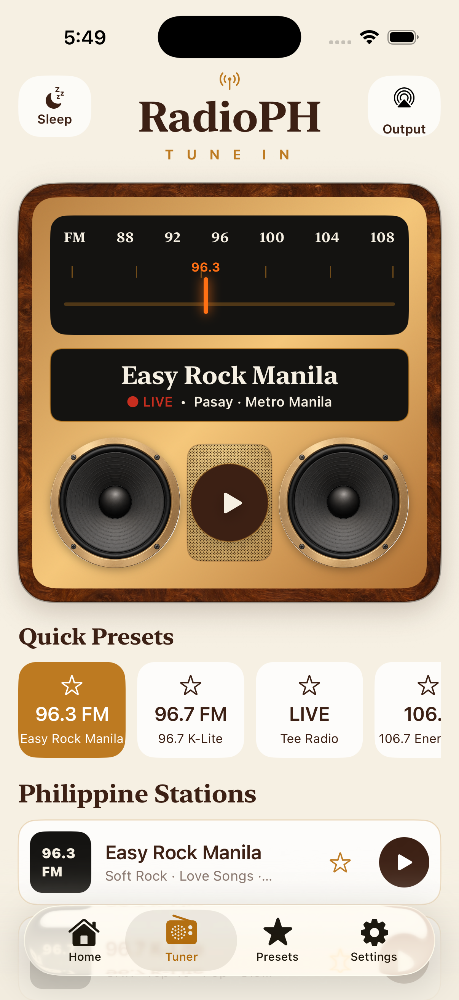

# RadioPH

RadioPH is a SwiftUI internet-radio prototype based on the selected **Heritage Dial** concept.

## Screenshot

## Included

- Retro walnut-and-brass tuner with analog station scale and tactile controls
- Curated catalog of 101 Philippine stations
- AVPlayer streaming with background audio and lock-screen metadata
- Browser-player fallback for stations such as K-Lite that do not publish a stable stream URL
- Station/city/genre search, genre filters, favorites, recent history, sleep timer
- Bluetooth/AirPlay route affordances, mini player, and dark mode
- Curated local station metadata so the app remains browsable without network access

Open `RadioPH.xcodeproj`, select the `RadioPH` scheme, and run on an iOS 17+ simulator.
